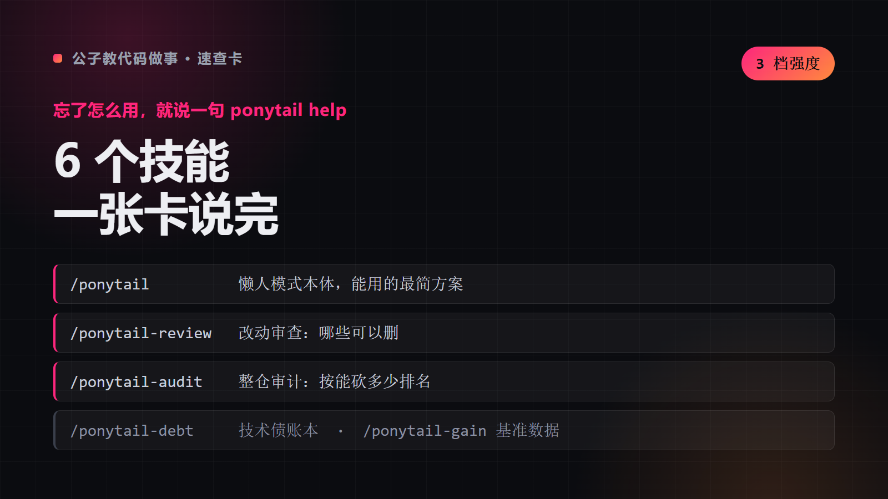

English | [中文](README.md)

# gongzi-teaches-code-help

An agent skill that prints **every mode, skill, and command** in one card, plus how to switch intensity, how to turn it off, and how to update.

Forgot how it works? Say `ponytail help`.



## Why it exists

Six skills, three intensity levels, a pile of commands. Two uses in, nobody remembers the difference between `/ponytail-audit` and `/ponytail-debt`.

So there's one card. One card is enough. Read it, close it.

## What it looks like

**Three intensity levels**

| Level | Trigger | What changes |
|---|---|---|
| **Lite** | `/ponytail lite` | Build what's asked, name the lazier alternative in one line |
| **Full** | `/ponytail` | The six-step ladder enforced. Default |
| **Ultra** | `/ponytail ultra` | YAGNI extremist. Challenges the requirement before the implementation |

A level sticks until you change it or the session ends.

**Six skills**

| Skill | Command | What it does |
|---|---|---|
| **ponytail** | `/ponytail` | Lazy mode itself: the simplest solution that works |
| **review** | `/ponytail-review` | Diff review: `L42: yagni: factory, one product. Inline.` |
| **audit** | `/ponytail-audit` | Whole-repo audit: a ranked list of what to delete |
| **debt** | `/ponytail-debt` | Harvests `ponytail:` comments into a tech-debt ledger |
| **gain** | `/ponytail-gain` | Benchmark scoreboard: less code, less cost, more speed |
| **help** | `/ponytail-help` | This card |

Codex uses `@ponytail`, `@ponytail-review`, `@ponytail-help`; Claude Code and OpenCode use the slash forms above.

## Turning it off

Say "normal mode" or `stop ponytail`. Come back anytime with `/ponytail`. `/ponytail off` works too.

## Changing the default level

Default is `full`, auto-active every session. To change it:

**Environment variable** (highest priority)

```bash
export PONYTAIL_DEFAULT_MODE=ultra
```

**Config file** (`~/.config/ponytail/config.json`, Windows: `%APPDATA%\ponytail\config.json`)

```json
{ "defaultMode": "lite" }
```

Set `"off"` to disable auto-activation and activate manually with `/ponytail` when wanted.

Priority: env var > config file > `full`.

## Updating

In Claude Code, open `/plugin` → Marketplaces → pick ponytail → Enable auto-update. New versions arrive at startup (run `/reload-plugins` when it prompts).

Manual refresh: `/plugin marketplace update ponytail`, then `/reload-plugins`.

`/plugin` not recognized? Your Claude Code is out of date. Update it (`npm install -g @anthropic-ai/claude-code@latest` or `brew upgrade claude-code`) and restart. Other hosts use their own update flow.

## Install

```bash
git clone https://github.com/chengangrun-ai/gongzi-teaches-code-help.git \
  ~/.workbuddy-ai/skills/gongzi-teaches-code-help
```

No dependencies, no pip install.

## Usage

```
/ponytail-help
```

Or just ask: "how does ponytail work?" / "what commands are there?"

## Boundaries

- One-shot display. Changes no mode, writes no files, leaves no trace.
- To exit: say "normal mode" or `stop ponytail`.

## Credits

Rewritten from [Ponytail](https://github.com/DietrichGebert/ponytail) (MIT, by DietrichGebert). The original copyright notice is preserved in `LICENSE`.

## License

MIT. See [LICENSE](LICENSE).

Made by [Gongzi](https://github.com/chengangrun-ai).
